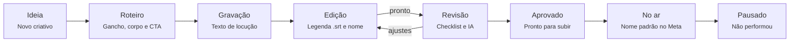

# Painel de Criativos — Guia completo

Atualizado em 18/10/2026.

## Visão geral

O Painel de Criativos organiza os vídeos de anúncio (Meta Ads) da ideia ao resultado: produção em quadro, nome padrão, roteiro e legenda, variações em massa, resultados do Gerenciador de Anúncios e IA.

**Endereço:** [criativos.mateus-dpaula10.workers.dev](https://criativos.mateus-dpaula10.workers.dev) (funciona no computador e no celular).

| Papel | Quem é | O que pode fazer |
| --- | --- | --- |
| Admin | Quem administra o painel | Tudo, inclusive adicionar e remover pessoas da equipe |
| Edição | Editores de vídeo | Tudo, menos mexer na equipe |
| Tráfego | Gestores de tráfego | Tudo, menos mexer na equipe |

| Tela | Para que serve |
| --- | --- |
| Início | Resumo: o que está em produção, atrasado, no ar, e quem performa melhor |
| Quadro | A esteira de produção: um cartão por criativo, uma coluna por etapa |
| Página do criativo | Tudo de um vídeo: dados, nome, roteiro, legenda, checklist, resultados, comentários |
| Variações | Gera várias versões (gancho × corpo × CTA) e o script que renderiza todas |
| Resultados | Importa o relatório do Meta e mostra o ranking dos criativos |
| Ajustes | Conta, tema, nome padrão, campanhas, equipe e uso da IA |

Cada criativo tem um **código único** (C0001, C0002…). Ele vai no nome do anúncio no Meta e é por ele que os resultados voltam para o painel.

## Primeiro acesso

A conta é criada pelo admin; você só entra com o e-mail e a senha que recebeu.

1. Abra o endereço do painel e preencha e-mail e senha em **Entrar no painel**.
2. No primeiro acesso, um **tour** mostra cada parte da tela. Dá para pular e refazer depois em **Ajustes → Refazer o tour**.
3. Em **Ajustes → Sua conta** você escolhe o tema (automático, claro ou escuro) e encontra o botão **Sair**.
4. Para trocar a senha, peça ao admin. O envio de e-mail ainda não está ligado, então o “Esqueci a senha” não chega por enquanto.

Se aparecer **“Acesso ainda não liberado”**, seu login existe mas seu e-mail ainda não foi colocado na equipe: peça ao admin para adicionar em Ajustes → Equipe e clique em **Tentar de novo**.

## Fluxo do dia a dia

Todo vídeo segue a mesma esteira de 8 etapas; cada passo abaixo diz o que fazer e em qual tela.

A revisão pode devolver o vídeo para Edição quantas vezes precisar; só o aprovado vai ao ar, e quem não performa termina em Pausado.

1. **Ideia (tráfego ou edição):** clique em **Novo criativo**, dê título, campanha, ângulo, responsável e prazo.
2. **Roteiro:** na página do criativo, escreva gancho, corpo e CTA (ou use **Sugerir com IA**) e clique em **Salvar roteiro**.
3. **Gravação:** baixe o **Texto de locução** para quem vai gravar.
4. **Edição (editor):** no CapCut ou Premiere, importe a **Legenda .srt** e exporte com o **nome do arquivo** que o painel mostra. Cole o link do vídeo final em **Dados** e clique em **Ler vídeo exportado**.
5. **Revisão (tráfego):** confira o **checklist**, use **Revisar com IA** se quiser e deixe ajustes nos **comentários**. Se precisar refazer, volte o cartão para Edição.
6. **Aprovado:** o vídeo está pronto para subir.
7. **No ar (tráfego):** suba no Meta usando **exatamente o nome do anúncio** do painel. O veredito vira “Em teste” sozinho.
8. **Resultados:** toda semana, importe o CSV do Gerenciador em **Resultados** e marque o veredito (Vencedor ou Perdedor). Quem não performa vai para **Pausado**; quem vence ganha **variações**.

## Tela Início

O Início responde em 10 segundos: o que está andando, o que atrasou e quem está performando. Tudo nela é clicável e leva ao quadro já filtrado.

| Parte | O que mostra |
| --- | --- |
| Em produção | Criativos entre Ideia e Revisão |
| Para revisar | Criativos na etapa Revisão |
| No ar | Criativos rodando no Meta |
| Atrasados | Em produção com prazo vencido (fica vermelho quando há algum) |
| Esteira | Quantos criativos há em cada uma das 8 etapas |
| Minhas entregas | Seus criativos em produção, do prazo mais próximo ao mais distante |
| Melhor custo por resultado · 7 dias | Investido, custo por resultado e retorno da semana, e os 5 criativos mais eficientes |

O botão **Novo criativo** fica no topo (no celular, é o botão amarelo **+** no canto).

## Tela Quadro

O Quadro é a esteira de produção: uma coluna por etapa e um cartão por criativo, atualizado na hora para toda a equipe.

**Cada cartão mostra:** miniatura, código, campanha, título, ângulo, prazo (vermelho se atrasado), veredito, formatos e as iniciais do responsável.

**Como mover um criativo de etapa:**

- No computador, **arraste** o cartão para outra coluna.
- No celular (ou pelo teclado), use as setas **‹ ›** no pé do cartão.
- Ou mude o campo **Etapa** dentro da página do criativo.

**Para encontrar:** busca por código, título, ângulo, campanha ou etiqueta; filtros por campanha e por responsável. O **+** no topo de cada coluna cria um criativo já naquela etapa.

**Regras automáticas:**

- Ao entrar em **No ar** sem veredito, o criativo ganha o veredito “Em teste”.
- Ao ir para **Aprovado** com o checklist incompleto, aparece um aviso (não bloqueia).
- Prazo só conta como atrasado enquanto o criativo está em produção (Ideia a Revisão).

## Página do criativo

Clicar num cartão abre a página do criativo, que guarda tudo daquele vídeo. No topo ficam **Etapa** e **Veredito**, que gravam na hora.

| Bloco | O que fazer |
| --- | --- |
| Nome do anúncio | Clique em **Copiar** e use no anúncio do Meta. Abaixo, o nome do arquivo para cada formato, para exportar no CapCut ou Premiere. |
| Vídeo | **Ler vídeo exportado**: escolha o .mp4 final; o painel preenche a duração, confere o formato, avisa se não está em 1080p e tira a miniatura. O vídeo não é enviado. **Revisar com IA**: veja a seção IA. |
| Roteiro | Blocos de Gancho, Corpo e CTA com o tempo de cada um (estimado pela fala se você não preencher os segundos). **Salvar roteiro** grava. **Legenda .srt** baixa a legenda; **Texto de locução** baixa o texto para gravar. |
| Dados | Título, campanha, ângulo, responsável, prazo, ferramenta, formatos, link do vídeo final, caminho do projeto, etiquetas e notas. Clique em **Salvar dados**. |
| Checklist de revisão | 7 itens (gancho, legenda, zona segura, áudio, CTA, formato, marca). Cada marcação grava na hora. |
| Resultados | Números do criativo (investido, resultados, custo por resultado, ROAS, CTR, CPM, taxa de gancho, retenção). **Lançar à mão** para quem não usa o CSV. |
| Variações | Mostra de quem este criativo é variação e as variações dele. **Gerar variações** abre o montador já com ele como base. |
| Comentários | Pedidos de ajuste e aprovações da equipe, em tempo real. |

**Como importar a legenda:** no CapCut, Texto → Legendas → Importar arquivo; no Premiere, Arquivo → Importar e arraste para a sequência.

**Duplicar** cria uma variação com os mesmos dados e roteiro, na etapa Roteiro. **Excluir** (lixeira) apaga o criativo com resultados e comentários e não tem volta.

O que você digita e ainda não salvou não se perde quando alguém da equipe mexe em outro criativo.

## IA

A IA (Claude Haiku 5.5, o modelo mais barato da Anthropic) escreve roteiros e revisa vídeos; ela só funciona depois que o admin colocar a chave com crédito (veja Administração técnica). Até lá, os botões avisam que a IA não foi ligada.

**Sugerir com IA** (bloco Roteiro):

1. Clique em **Sugerir com IA**.
2. Escreva o **contexto**: a história, a oferta, o que já tem gravado. Opcional: público e duração alvo.
3. Clique em **Gerar sugestões**. Vem 8 ganchos e 3 roteiros completos.
4. **Usar** troca só o gancho; **Usar este roteiro** troca o roteiro inteiro.
5. Revise o texto e clique em **Salvar roteiro**.

Como referência, a IA recebe os 3 criativos com roteiro e menor custo por resultado nos últimos 30 dias (da mesma campanha primeiro). Ela não inventa números: onde precisar de um dado, escreve [DADO] para você preencher.

**Revisar com IA** (bloco Vídeo):

1. Clique em **Revisar com IA** e escolha o .mp4 exportado.
2. O painel tira 8 quadros (imagens) do vídeo e envia só eles, junto com o roteiro.
3. A IA avalia gancho, legenda, zona coberta pela interface, CTA, marca e enquadramento. O áudio não é avaliado.
4. **Marcar os aprovados no checklist** marca só o que passou; **Salvar como comentário** guarda o parecer na conversa do criativo.

**Custo:** cada uso custa cerca de US$ 0,001 a 0,01. O total do mês aparece em **Ajustes → IA neste mês**.

## Variações

O montador junta ganchos, corpos e CTAs já exportados em todas as combinações: cria um criativo para cada uma e um script que renderiza tudo sozinho no seu PC. Exemplo: 3 ganchos × 1 corpo × 2 CTAs × 2 formatos = 6 criativos e 12 vídeos.

**Antes:** no CapCut ou Premiere, exporte cada gancho, cada corpo e cada CTA como um arquivo separado, todos na mesma pasta. O PC precisa ter o **ffmpeg** instalado (já está no PC de edição; em outro, rode `winget install Gyan.FFmpeg`).

1. Abra **Variações** (ou **Gerar variações** dentro de um criativo, que já preenche a base).
2. Escolha campanha, ângulo e responsável.
3. Em **Pasta dos clipes no PC**, cole o endereço da pasta (no Explorador de Arquivos, clique na barra de endereço e copie). A pasta de saída é opcional; em branco, vira a subpasta `render`.
4. Liste os arquivos em **Ganchos**, **Corpos** e **CTAs** (um por linha) ou clique em **Escolher arquivos**.
5. Marque os formatos e o ajuste: **Cortar e preencher** (recomendado) ou **Barras pretas**. Se os clipes forem mudos, desmarque **Os clipes têm áudio**.
6. Confira a prévia e clique em **Criar e baixar script**. Os criativos entram em **Edição** e um arquivo `.bat` é baixado.
7. Dê **duplo clique no .bat**. Os vídeos saem na pasta de saída já com o nome de cada criativo.

Limite de 60 combinações por vez. O mesmo script pode ser baixado de novo dentro de cada criativo (bloco Variações).

## Resultados

Os números chegam pelo CSV do Gerenciador de Anúncios: o painel reconhece cada anúncio pelo código (C0042) no nome. Anúncio sem código no nome fica de fora.

**Exportar do Meta:**

1. No Gerenciador de Anúncios, abra a aba **Anúncios** e escolha o período.
2. Em **Detalhamento → Por tempo → Dia**.
3. Colunas: valor usado, impressões, cliques no link, reproduções de vídeo de 3 segundos, ThruPlays, resultados (ou compras) e valor de conversão.
4. **Relatórios → Exportar dados da tabela → .csv**.

**Importar no painel:**

1. Em **Resultados**, clique em **Importar CSV** e escolha o arquivo.
2. Confira o resumo: quantos criativos foram reconhecidos, o período e os anúncios que ficaram de fora. Se o Meta mudou o nome de alguma coluna, escolha a certa em **Colunas do arquivo**.
3. Clique em **Importar**. Reimportar o mesmo período substitui os números, não duplica.

| Métrica | Conta | Para que serve |
| --- | --- | --- |
| Custo por resultado (CPA) | Investido ÷ resultados | Quanto custa cada doação ou venda; o menor ganha o selo “Menor custo” |
| ROAS | Valor de conversão ÷ investido | Quanto volta para cada real investido |
| CTR | Cliques no link ÷ impressões | Se o vídeo faz a pessoa clicar |
| Taxa de gancho | Reproduções de 3 s ÷ impressões | Se o começo para a rolagem |
| Retenção | ThruPlays ÷ reproduções de 3 s | Se quem começou assiste até o fim |
| CPM | Investido ÷ impressões × 1.000 | Custo de alcance |

Use os botões de período (7, 14, 30, 90 dias ou tudo) e o filtro de campanha. Clique no nome de uma coluna para ordenar.

## Ajustes

Em Ajustes ficam as configurações da equipe; o que muda aqui vale para todos, menos o tema, que é de cada aparelho.

| Bloco | O que fazer |
| --- | --- |
| Sua conta | Tema (automático, claro, escuro), **Refazer o tour** e **Sair** |
| IA neste mês | Chamadas, tokens e custo estimado da IA no mês |
| Nome dos anúncios | Modelo do nome, montado com as variáveis (clique numa para inserir). `{codigo}` é obrigatório. Padrão: `{campanha}_{codigo}_{angulo}_{data}` |
| Pasta padrão dos clipes | Pasta que o montador de variações já traz preenchida |
| Campanhas | Abrigos, ofertas ou produtos. A **sigla** entra no nome do anúncio; a **cor** marca os cartões. Desmarque **Ativa** para esconder sem apagar. |
| Equipe (só admin) | **Adicionar** e-mail, nome e papel; editar ou **Remover da equipe**. Quem é removido perde o acesso na hora. |

**Cadastre as campanhas antes dos primeiros criativos.** Trocar a sigla ou o modelo depois muda o nome que o painel mostra, mas os anúncios já publicados no Meta continuam com o nome antigo. Os resultados continuam casando, porque o que vale é o código.

## Administração técnica

O painel roda em três serviços gratuitos; esta seção é para o admin.

| Serviço | O que guarda | Onde |
| --- | --- | --- |
| Supabase (projeto `criativos`) | Banco, logins, miniaturas e a função de IA | supabase.com |
| Cloudflare (Worker `criativos`) | O site publicado | dash.cloudflare.com → Workers e Pages |
| GitHub | O código | [mateus-dpaula10/criativos](https://github.com/mateus-dpaula10/criativos) |

**Adicionar uma pessoa:**

1. Supabase → **Authentication → Users → Add user → Create new user**: e-mail, senha e **Auto Confirm User** marcado.
2. Painel → **Ajustes → Equipe → Adicionar**, com o mesmo e-mail e o papel.
3. Passe o endereço, o e-mail e a senha para a pessoa.

**Trocar a senha de alguém:** Supabase → Authentication → Users → a pessoa → defina uma senha nova.

**Remover uma pessoa:** Ajustes → Equipe → Remover (perde o acesso na hora). Para apagar o login também, Supabase → Authentication → Users → Delete.

**Ligar a IA:**

1. Em console.anthropic.com (conta pessoal), coloque crédito em **Billing** e crie a chave em **API Keys**.
2. Supabase → **Edge Functions → Secrets**: `ANTHROPIC_API_KEY` = a chave. Para um modelo melhor (e mais caro), crie `IA_MODELO` = `claude-sonnet-5-5`.
3. Supabase → Edge Functions → `ia` → cole o arquivo `supabase/functions/ia/index.ts` do GitHub e clique em **Deploy** (a verificação de JWT da função fica desligada).

**Publicar uma mudança no painel:** todo `git push` na branch `main` publica sozinho na Cloudflare em 1 a 2 minutos. Mudanças no banco são feitas no **SQL Editor** do Supabase com o arquivo `supabase/schema.sql` (pode rodar de novo sem quebrar).

**Ligar o e-mail (opcional):** Supabase → Authentication → Emails → SMTP Settings, com o Resend. Depois disso cada pessoa faz o próprio “Primeiro acesso” e o “Esqueci a senha” funciona.

## Problemas comuns

| O que aparece | Por que | O que fazer |
| --- | --- | --- |
| “E-mail ou senha incorretos” | Senha errada ou login não criado | Confira com o admin; ele redefine a senha no Supabase |
| “Acesso ainda não liberado” | O e-mail não está na equipe | Admin adiciona em Ajustes → Equipe; depois **Tentar de novo** |
| “A IA ainda não foi ligada” ou “sem crédito” | Falta a chave ou o crédito da Anthropic | Admin segue “Ligar a IA” |
| “Este navegador não consegue ler esse vídeo” | Vídeo em formato que o Chrome não abre (ex.: ProRes, .mov) | Exporte em MP4 H.264 |
| Resultado não aparece depois do CSV | O nome do anúncio no Meta não tem o código C0000 | Renomeie o anúncio no Meta com o nome do painel e exporte de novo |
| O CSV não reconhece uma coluna | O Meta mudou o nome da coluna | Escolha a coluna certa em **Colunas do arquivo** |
| O .bat diz “ffmpeg não encontrado” | O PC não tem ffmpeg | Rode `winget install Gyan.FFmpeg` e abra o .bat de novo |
| O .bat termina com falhas | Arquivo com nome diferente, fora da pasta, ou clipe sem áudio | Confira os nomes e a pasta; se os clipes forem mudos, desmarque “Os clipes têm áudio” |
| Aviso “A equipe atualizou criativos” | Alguém mexeu enquanto você digitava | Clique em **Atualizar** quando terminar; o que você digitou não se perde |
